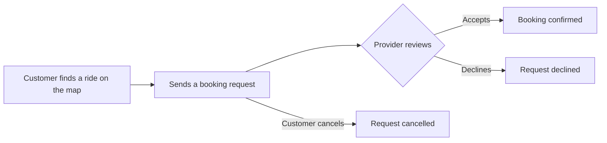

<div align="center">

# 🚗 Safe Rides

### Find the right ride. Own the road.

A vehicle rental website where people discover cars, bikes, scooters and cycles near them, and local providers list their own vehicles.

<a href="https://safe-rides-nu.vercel.app"></a>


</div>

---

## 🌐 Live Website

🔗 **Visit here:** [https://safe-rides-nu.vercel.app](https://safe-rides-nu.vercel.app)

Open the link, browse the sample fleet, try the pickup map, and create an account to explore booking requests and the referral rewards.

## 📌 About the Project

Safe Rides is a static vehicle-rental website built as a **CSE326 assignment**. It shows how a small, serverless web app can combine a clean interface, user accounts, a live database and a map to connect people who want to rent a vehicle with people who have one to offer.

Customers browse rentals, find the closest pickup point on a map and send booking requests. Providers publish vehicles with a real pickup pin and accept or decline requests. Verified users can also earn ride discounts through a 45-day referral campaign.

## ✨ Features

### 🧑 For customers

- 🚘 Browse rentals by category: **Cars, Bikes, Scooters and Cycles**
- 🗺️ **Pickup map** with a pin for every vehicle
- 📍 Search a place, use your **current location**, or click the map, and rentals are sorted by distance
- 📝 Send a **booking request** for chosen dates; a booking is confirmed only after the provider accepts it
- 📋 Track your requests and cancel a pending one

### 🏢 For providers and businesses

- 🔄 Switch an account to a **provider account**
- ➕ List a vehicle with name, type, year, daily price, city, photo and features
- 📌 Choose the **exact pickup point** by clicking the map
- ⏸️ Pause or re-open a listing at any time
- ✅ Accept or decline incoming booking requests

### 🔐 Accounts and security

- ✉️ Email and password sign-up with a **verification email** (with resend)
- 🔑 Sign-in, **password reset** and sign-out
- 🔵 **Google sign-in**
- 🛡️ Firestore security rules protect user data (see below)

## 🎁 Referral Campaign

Signed-in users see a **45-day referral event** with a three-friend progress bar.

| Friends who joined | Reward |
|:---:|---|
| 1 | 🎟️ 20% off your next ride |
| 2 | 🎟️ 20% off your next ride |
| 3 | 🏆 50% off your next ride |

A friend counts once, after creating a new account with your invite link. Unverified email/password accounts cannot count as referrals, and each user can earn a maximum of three referrals.

## 🔄 How a Booking Works



## 🛠️ Technologies Used

| Layer | Technology |
|---|---|
| Front end | HTML, CSS and JavaScript (single page, no build step) |
| Maps | [Leaflet](https://leafletjs.com/) with OpenStreetMap-based map tiles |
| Accounts | Firebase Authentication (Email/Password and Google) |
| Database | Cloud Firestore |
| Hosting | [Vercel](https://vercel.com/) (static deployment) |
| Images | Vehicle photos loaded from Unsplash |

## 🗂️ Project Structure

```
safe-rides/
├── index.html           # Page layout, styles and main app logic
├── leaflet-maps.js      # Map, pins, distance sorting and place search
├── firebase-config.js   # Firebase web app configuration (public client config)
├── firestore.rules      # Firestore security rules
├── favicon.svg          # Site icon
├── .gitignore
└── README.md
```

## 🔥 Firebase Setup

Firebase Authentication is connected to the **Safe Rides Vehicle Rental** project.

**Enabled sign-in providers:** Email/Password and Google.

**Email verification:** email/password sign-ups receive a Firebase verification email. Users can resend it from the website, and after following the link they return to Safe Rides or refresh the page. Google sign-in uses the provider's verified email status.

**Firestore data** is stored in these collections:

| Collection | Purpose |
|---|---|
| `userProfiles` | Account type (customer or provider) and business name |
| `vehicles` | Provider vehicle listings with pickup coordinates |
| `bookingRequests` | Customer requests and their status |
| `referralProfiles` | Referral start time and count for each user |
| `referrals` | Which user invited which new account |

**Security rules** (in `firestore.rules`) require verified email claims for referral writes, limit each account to one referral record, cap the count at three, enforce the 45-day window, and stop users from listing other people's profiles.

> ⚠️ The Firebase web config in `firebase-config.js` is public client configuration. **Never** put a service-account JSON file or private key in this repository.

To use your own Firebase project, enable Authentication and Cloud Firestore, paste your web app settings into `firebase-config.js`, publish `firestore.rules`, and add your site's domain under **Authentication → Settings → Authorized domains**.

## 🚀 How to View the Project

1. Open the live website: [https://safe-rides-nu.vercel.app](https://safe-rides-nu.vercel.app)
2. Browse the rides and try the pickup map.
3. Create an account, verify your email and explore bookings and the referral progress.

**To run it locally:** download or clone this repository, then serve the folder (for example with `npx serve`) and open it in your browser. A local server or the live site is better than opening `index.html` straight from disk, because map tiles may not load from a file path. An internet connection is needed for the map, Firebase and the vehicle photos.

## ☁️ Deployment

The site is a plain static site with no build step. On Vercel, import the repository with the **Other** framework preset and leave the build command and output directory empty. After deploying, add the Vercel domain to Firebase **Authorized domains** so sign-in works.

## 💡 Notes

- The vehicles shown by default are a **sample fleet** for demonstration. Only listings created by provider accounts can receive real booking requests.
- The map and place search use free OpenStreetMap services, which suit a small project rather than heavy traffic.

## 🎯 Project Objective

To apply web development skills to build a complete, working rental platform: a responsive interface, secure user accounts, a live database, an interactive map and a rewards system, all deployed as a static website.

## 🎓 Course

**CSE326** assignment

<div align="center">

⭐ If you like this project, consider giving the repository a star!

*Made with ❤️ as a college web development project.*

</div>
